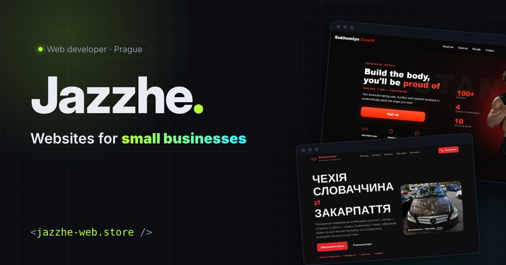
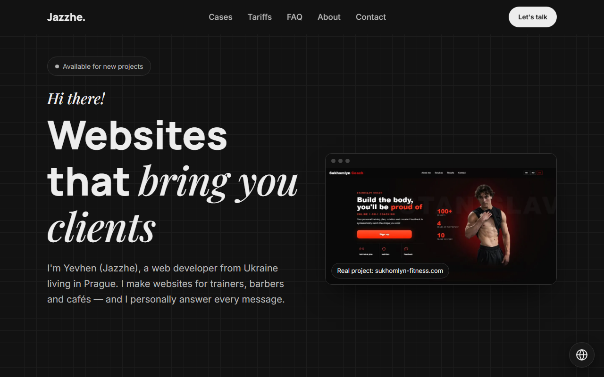
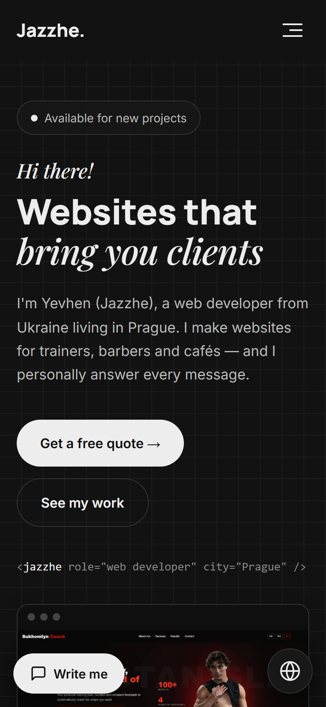
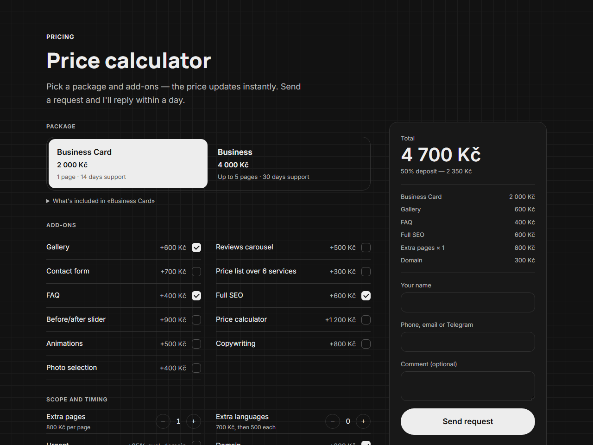
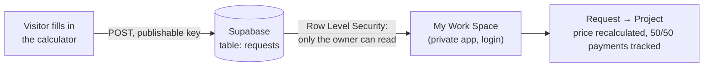
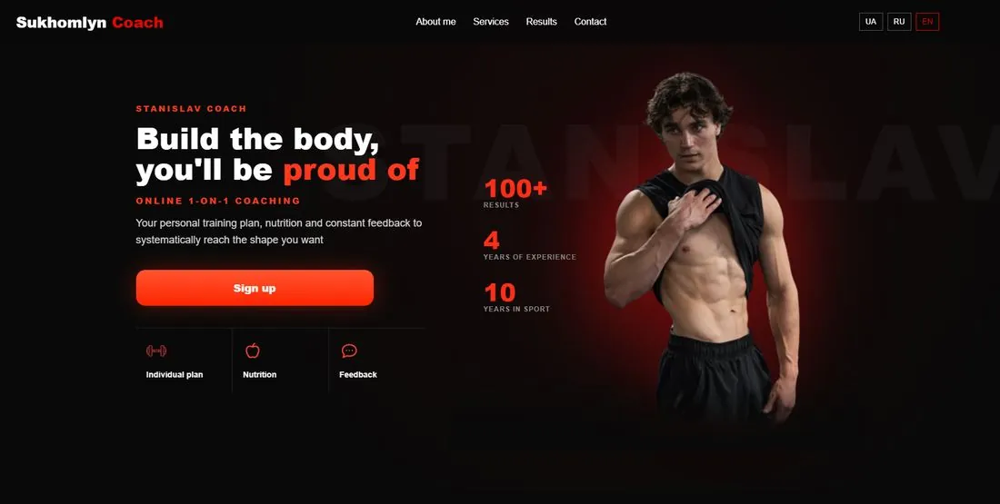
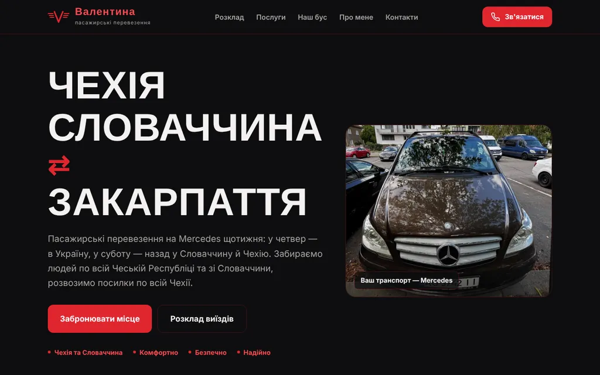
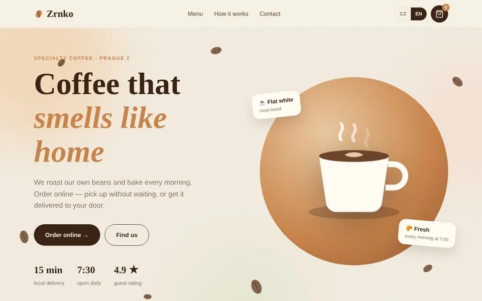
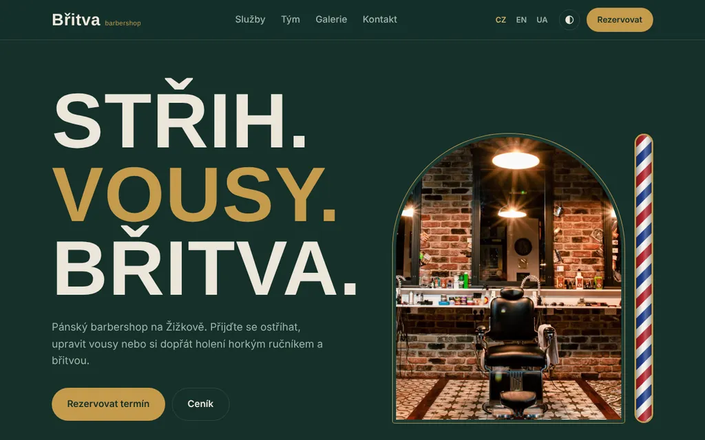
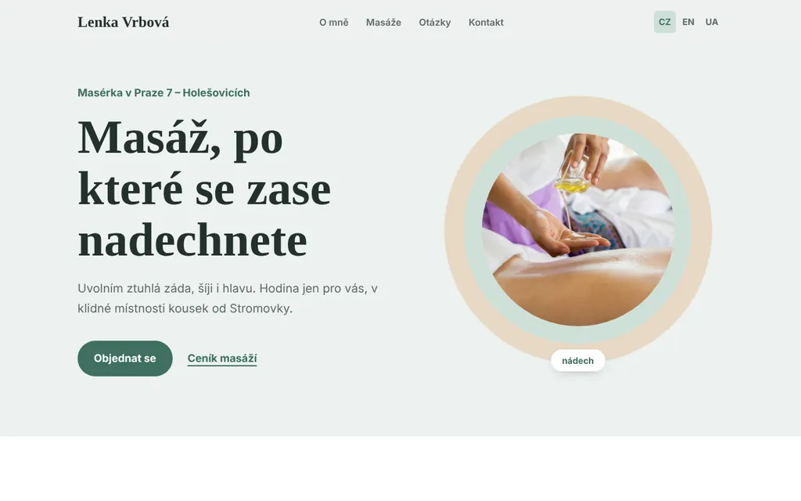

<div align="center">



# Jazzhe.

**Websites that bring you clients** — portfolio and service site of a freelance web developer in Prague.

[**jazzhe-web.store**](https://jazzhe-web.store) · [WhatsApp](https://wa.me/420778583552) · [Telegram](https://t.me/sasaimne) · [Instagram](https://instagram.com/evhanjazzhe) · [Fiverr](https://www.fiverr.com/yevhen_bahrynov)


</div>

---

## About

I'm Yevhen (Jazzhe), a web developer from Ukraine living in Prague. I build fast, modern websites for small businesses — trainers, barbers, cafés, therapists — and personally answer every message.

This repository is the site itself: **no frameworks, no build step**, just hand-written HTML, CSS and JavaScript served by GitHub Pages. It loads fast, works on any phone and is easy to maintain.

<p align="center">
  
  &nbsp;
  
</p>

## Features

| | |
|---|---|
| 🌍 **4 languages** | Ukrainian, Czech, English and Russian — switched instantly, choice is remembered |
| 🧮 **Price calculator** | Opens from any package's *Order* button: tick add-ons, see the price live, send a request in one click |
| 📨 **Requests go straight to my CRM** | Submissions land in Supabase and show up in my private *My Work Space* app |
| 🖼️ **Real case studies** | Live client projects plus interactive demo sites with before/after sliders |
| 📱 **Great on phones** | Every section adapts to small screens; quick-contact button always at hand |
| ⚡ **Fast** | No frameworks, lazy-loaded WebP images, fonts preconnected |
| 🔎 **SEO ready** | Meta tags, Open Graph image, JSON-LD, `sitemap.xml`, `robots.txt` |

## Price calculator

Clicking **Order** on a package (or **Get a free quote**) opens the calculator in a window with that package already selected. Clients tick add-ons and immediately see the total and the 50% deposit, then send a request — or jump to WhatsApp with the calculation pre-filled. If the *Business* package works out cheaper than *Business Card* with the same add-ons, the calculator says so.

<p align="center"></p>

## How requests work



1. The calculator sends only the **selected options** (package, add-ons, pages, languages), the client's name, contact and comment.
2. **Supabase** stores the request. Row Level Security allows anonymous visitors to *insert* only — nobody can read other people's requests.
3. In **My Work Space** I log in, see new requests, and turn one into a project with a single click. The price is **recalculated on my side**, so a tampered price from the browser is never trusted.
4. Spam protection: a hidden honeypot field and a one-request-per-minute limit per browser.

## Case studies

| | Project | Link |
|---|---|---|
|  | **Personal trainer** — online coaching site with sign-up | [sukhomlyn-fitness.com](https://sukhomlyn-fitness.com) |
|  | **Passenger transport** — schedule, route map and quick contact via Viber/WhatsApp | [valentyna-driver.com](https://www.valentyna-driver.com) |
|  | **Zrnko café** — online coffee shop demo | [cafe.html](https://jazzhe-web.store/cafe.html) |
|  | **Břitva barbershop** — dark/light theme demo | [barber.html](https://jazzhe-web.store/barber.html) |
|  | **Massage therapist** — one-page business card | [vizitka.html](https://jazzhe-web.store/vizitka.html) |

## Project structure

```
├── index.html            # main page: markup only
├── assets/
│   ├── css/
│   │   ├── style.css     # design system: colours, layout, sections
│   │   └── calc.css      # price calculator window
│   └── js/
│       ├── main.js       # translations, language switcher, menus, sliders, animations
│       └── calc.js       # price calculator + request sending
├── cafe.html  barber.html  vizitka.html   # demo sites for case studies
├── img-*.webp / img-og-image.jpg          # optimised images
├── docs/                 # screenshots for this README
├── CNAME                 # custom domain: jazzhe-web.store
├── sitemap.xml  robots.txt
```

**Design:** monochrome dark theme, subtle grid background, *Manrope* for headings, *Inter* for text and *Playfair Display* italics for accents. All colours live in CSS variables at the top of `assets/css/style.css`.

**Translations:** every text element has a `data-i18n` key; `main.js` holds the dictionary for all four languages and swaps the text without reloading the page.

## Run locally

No installation needed:

```bash
git clone https://github.com/Zhenkaweb/zhenkaweb.github.io.git
cd zhenkaweb.github.io
python -m http.server 8000
```

Then open <http://localhost:8000>. Every push to `main` is published automatically by GitHub Pages.

---

<div align="center">

Need a website for your business? **[Get a free quote →](https://jazzhe-web.store/#calc)**

© Jazzhe · Prague

</div>
